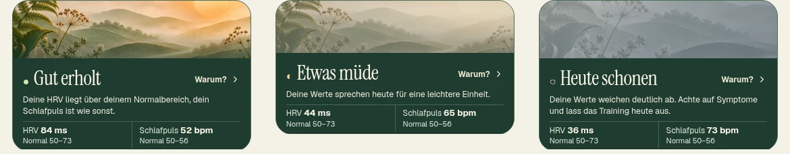

# happen Coach · Heute, Designrunde 2

Die 26 Ansichten wurden aus der PWA bei 390 CSS-Pixeln gerendert. Die Beispieldaten orientieren sich am [Coach-Plan](Coach-Plan.md) und enthalten keine persönlichen Messdaten.

| Heute | Hell | Dunkel |
|---|---|---|
| Gut erholt | [Hell](images/coach-r2/light-01-gruen.webp) | [Dunkel](images/coach-r2/dark-01-gruen.webp) |
| Etwas müde | [Hell](images/coach-r2/light-02-gelb.webp) | [Dunkel](images/coach-r2/dark-02-gelb.webp) |
| Heute schonen | [Hell](images/coach-r2/light-03-rot.webp) | [Dunkel](images/coach-r2/dark-03-rot.webp) |
| Nacht noch nicht synchronisiert | [Hell](images/coach-r2/light-04-nacht-fehlt.webp) | [Dunkel](images/coach-r2/dark-04-nacht-fehlt.webp) |
| Lernphase, Tag 4 von 10 | [Hell](images/coach-r2/light-05-lernphase.webp) | [Dunkel](images/coach-r2/dark-05-lernphase.webp) |
| Keine Uhr verbunden | [Hell](images/coach-r2/light-06-ohne-uhr.webp) | [Dunkel](images/coach-r2/dark-06-ohne-uhr.webp) |
| Lauf erledigt | [Hell](images/coach-r2/light-07-lauf-erledigt.webp) | [Dunkel](images/coach-r2/dark-07-lauf-erledigt.webp) |
| Frage beantwortet | [Hell](images/coach-r2/light-08-notiert.webp) | [Dunkel](images/coach-r2/dark-08-notiert.webp) |
| Garmin-Schlüssel abgelaufen | [Hell](images/coach-r2/light-09-schluessel-abgelaufen.webp) | [Dunkel](images/coach-r2/dark-09-schluessel-abgelaufen.webp) |

| Details und Komponenten | Hell | Dunkel |
|---|---|---|
| Tageslinie | [Hell](images/coach-r2/light-10-tageslinie.webp) | [Dunkel](images/coach-r2/dark-10-tageslinie.webp) |
| Warum? | [Hell](images/coach-r2/light-11-warum.webp) | [Dunkel](images/coach-r2/dark-11-warum.webp) |
| Laufanalyse | [Hell](images/coach-r2/light-12-laufanalyse.webp) | [Dunkel](images/coach-r2/dark-12-laufanalyse.webp) |
| Komponentenblatt | [Hell](images/coach-r2/light-13-komponenten.webp) | [Dunkel](images/coach-r2/dark-13-komponenten.webp) |

## Entscheidungen und Prüfung

| Korrektur | Umsetzung im Screen |
|---|---|
| 1 · Nochmal prüfen | Nur bei fehlender Nacht. Die synchronisierte Karte führt über „Warum?“ zu den Details. |
| 2 · Statussymbol | ●, ◐ und ○ stehen direkt vor dem Statuswort. |
| 3 · Erklärsatz | Der Satz ordnet die vorhandenen Signale ein. Beim Atemmuster gibt Happen den vorgesehenen Ruhehinweis. |
| 4 · Normalbereiche | Beide Grenzen werden ausgegeben, auch wenn sie zusammenfallen. |
| 5 · Kontrast | Die Landschaft endet über einer deckenden Fläche. Die kleinste gemessene Kontrastrate für Text und Statussymbol beträgt **8,41:1** in Hell und Dunkel. |
| 6 · kcal-Band | Das Tagesziel liegt als blasses Band hinter der kräftigen Spanne der erfassten Mahlzeiten. |
| 7 · Kontext Essen | Der Hinweis erscheint bei einer niedrigen erfassten Spanne zur Mittagszeit oder bei einer passenden Empfehlung aus dem Briefing. |
| 8 · Überschrift | „Heute“ und das Datum stehen in einer Zeile neben dem Profil. |
| 9 · Andere Aktivität | Der sichtbare Menüeintrag öffnet die Aktivitäts-Chips. |
| 10 · Chips | Einzeilige Beschriftungen, 44 px Höhe und flexible Breiten. |

- In allen getesteten Zuständen bei 390 × 844 px steht die Frage oberhalb der Tab-Leiste. Ein Antwort-Tipp speichert die Notiz. Die Bestätigung verschwindet anschließend.
- Die Landschaften verwenden Zuschnitt und Farbfilter auf demselben lokalen Motiv. In der Lernphase entspricht der farbige Anteil den vorhandenen Messtagen. Die Darstellung ist statisch, damit sich der Zustand auch bei reduzierter Bewegung unmittelbar erkennen lässt.
- „Warum?“ und die Laufanalyse öffnen sich als Dialog, damit beim Schließen die Position auf „Heute“ erhalten bleibt. Die Laufanalyse übernimmt vorhandene Werte und Zeitreihen aus der gespeicherten Analyse. Die Bilder zeigen Beispieldaten. FIT-Import und automatische Laufbewertung gehören zur M4-Implementierung.
- Das grüne Beispiel zeigt den Schlafpuls neben HRV, weil beide Größen direkt in die Erholungsbewertung eingehen. Ein Vergleich erscheint nur, wenn die Daten dafür vorliegen.
- Die Bildschirmprüfung lief in Chromium. Die Abnahme auf einem echten iPhone mit installiertem Happen steht aus.
