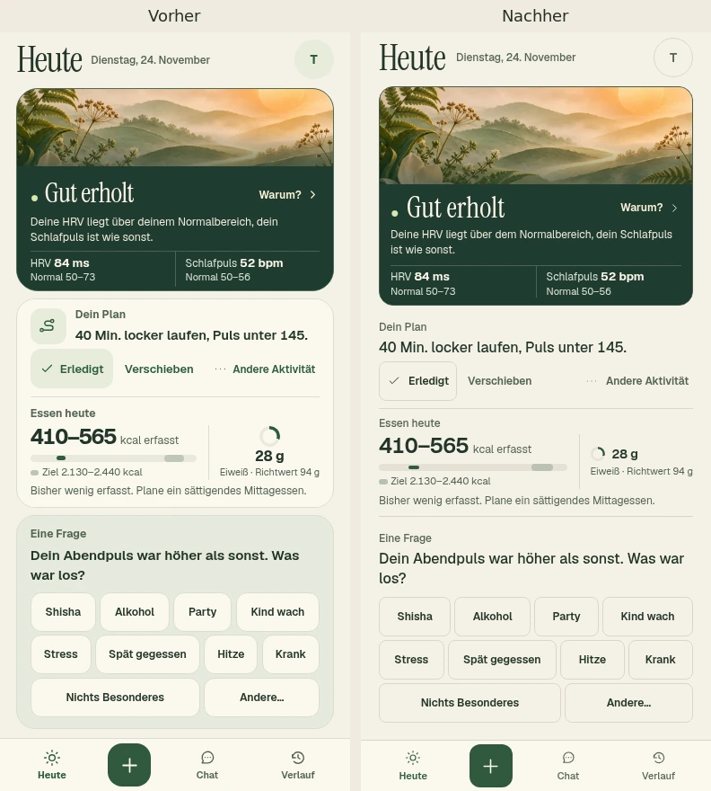

# Heute · Vorher und nachher

Die Ansichten stammen aus der PWA mit denselben Beispieldaten bei 390 × 844 CSS-Pixeln.

## Klarere Lesereihenfolge

Die Erholung gibt den Einstieg. Die Empfehlung im Trainingsplan hat die nächsthöhere Gewichtung. „Warum?“ öffnet die Messwerte mit Normalbereichen. „Plan ändern“ öffnet Verschieben und andere Aktivitäten. Die Frage lässt sich weiterhin mit einem Tipp beantworten.

[Lesereihenfolge in Hell](images/coach-feinschliff/lesereihenfolge-hell.webp) · [Lesereihenfolge in Dunkel](images/coach-feinschliff/lesereihenfolge-dunkel.webp)

## Erster Feinschliff

[Vergleich in Hell](images/coach-feinschliff/vergleich-hell.webp) · [Vergleich in Dunkel](images/coach-feinschliff/vergleich-dunkel.webp) · [Vergleich der Tageslinie](images/coach-feinschliff/vergleich-tageslinie.webp)

## Richtung

- **Produkt.** Ein Tagebuch, in dem du deine Erholung einordnest und Training und Mahlzeiten für den Tag festhältst.
- **Charakter.** Ruhig, präzise und warm.
- **Material.** Helles Papier und dunkler Graphit neben der waldgrünen Erholungskarte.
- **Schwerpunkt.** Die Landschaft macht die Erholung beim Öffnen sichtbar.
- **Wiedererkennung.** Dieselbe Landschaft verändert sich mit der Nacht.

## Was sich optisch geändert hat

| Stelle | Beobachtung | Überarbeitung |
|---|---|---|
| Plan, Ernährung und Frage | Die eingefärbten Flächen wirkten gleich wichtig. | Haarlinien gliedern den Tag. Die Erholung behält die kräftigste Fläche. |
| Trainingsplan | Das Icon belegte eine eigene Spalte und brach längere Sätze früher um. | Der Plan beginnt bündig unter seinem Label. Die Bedienelemente nutzen abgestufte Textrollen. |
| Ernährung | Ring und Eiweißwert standen optisch auseinander. | Ring, Wert und Richtwert bilden eine Gruppe. Die Kalorienspanne bleibt die Hauptzahl. |
| Rückfrage | Die Karte und jeder Chip hatten eine eigene Fläche. | Der Fragesatz steht direkt auf dem Seitenhintergrund. Die Chips bekommen eine dünne Kontur und bleiben 44 px hoch. |
| Tageslinie | Die umrandeten Gruppen und gefüllten Symbole konkurrierten mit der Zeitachse. | Zeiten, Linien-Icons und Text stehen in festen Spalten entlang einer einzigen Linie. |
| Navigation | Im Dunkelmodus kam eine weitere grüne Fläche hinzu. | Die Leiste nutzt einen warmen Neutralton. Das Plus bleibt die sichtbarste Aktion. |

Geprüft in Chromium in Hell und Dunkel. Der Erholungsbereich erreicht mindestens 8,41:1 Textkontrast. Die Frage ist in allen neun getesteten „Heute“-Zuständen oberhalb der Tab-Leiste sichtbar.

Methodik nach [Unslop von Damir Sokolovsky](https://github.com/heydamir/unslop).
